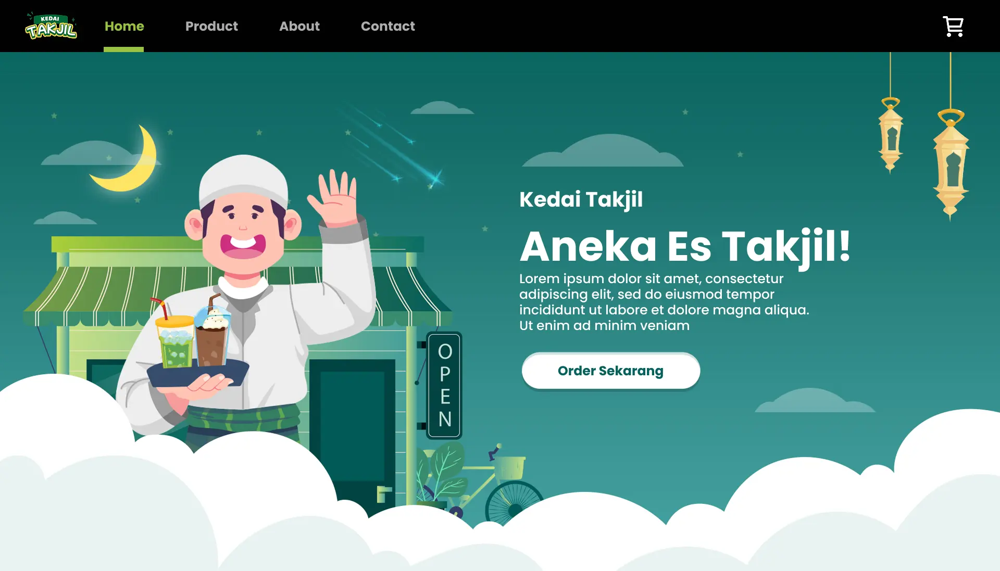
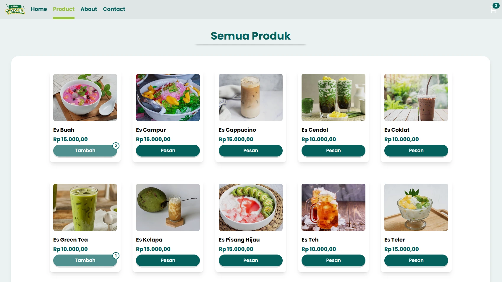
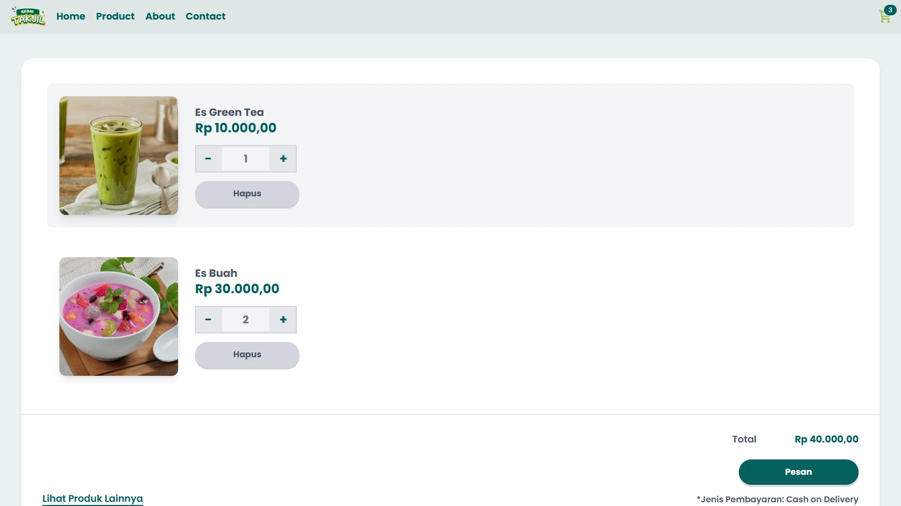

# Kedai Takjil

A responsive mini e-commerce web application for browsing takjil products and placing orders.

## 1. Overview

### Home



### Products



### Cart & Checkout



Kedai Takjil is a full-stack portfolio project demonstrating frontend development, REST API integration, and database management.

Users can browse products, manage a shopping cart, and place orders through a checkout flow.

## 2. Features

- Browse available takjil products and view product details.
- Add products to the shopping cart.
- Update product quantities and remove items from the cart.
- Calculate the total order amount.
- Submit orders through the checkout flow.
- Handle loading states and API errors with retry functionality.

## 3. Tech Stack

- **Frontend:** React, Vite, Tailwind CSS
- **Routing:** React Router
- **Backend:** PHP, Laravel 13
- **Database options:**
  - MySQL-compatible database (TiDB Cloud)
  - Microsoft SQL Server (local development)
  - MongoDB Atlas (production backend on Render)
- **Containerization:** Docker
- **Deployment:** Vercel (frontend), Render (backend)

## 4. Architecture

The application separates the frontend and backend to keep user interface responsibilities separate from business logic and data management.

### Production architecture

```text
User
  |
  v
React Frontend (Vercel)
  |
  | REST API (JSON)
  v
Laravel Backend (Docker on Render)
  |
  v
MongoDB Atlas
```

### Database configurations

The backend has been tested with different database configurations:

| Environment | Database                               | Purpose                                                 |
| ----------- | -------------------------------------- | ------------------------------------------------------- |
| Local       | MySQL-compatible database (TiDB Cloud) | MySQL-compatible development/configuration              |
| Local       | Microsoft SQL Server (MSSQL)           | Alternative local database configuration                |
| Production  | MongoDB Atlas                          | Database used by the Laravel backend deployed on Render |

Database drivers, connection variables, migrations, and query implementations may differ between configurations. Use the configuration and code that match the backend version being run.

```text
Website-Kedai-Takjil/
├── development/
│   ├── backend/
│   │   ├── app/             # Application logic and models
│   │   ├── database/        # Migrations and seeders
│   │   ├── routes/          # API and web routes
│   │   ├── tests/           # Backend tests
│   │   └── Dockerfile
│   └── frontend/
│       └── src/
│           ├── app/         # Application setup and routing
│           ├── components/  # Reusable UI components
│           ├── context/     # Shared cart state
│           ├── hooks/       # Custom React hooks
│           ├── pages/       # Application pages
│           ├── sections/    # Page sections
│           └── utils/       # Utility functions
└── README.md
```

The frontend manages the user interface and cart state, while the backend handles API requests, business logic, database operations, and order processing.

### How It Works

1. The frontend requests product data from the Laravel API.
2. Users select products and manage their shopping cart in the browser.
3. The frontend sends order details to the backend during checkout.
4. The backend validates the request, calculates order totals using database prices, and stores the order and its items.

The shopping cart uses browser `localStorage` to preserve its contents across page reloads.

### API Reference

The Laravel backend provides the following REST API endpoints:

| Method | Endpoint             | Description                             |
| ------ | -------------------- | --------------------------------------- |
| `GET`  | `/api/products`      | Retrieve the product list.              |
| `GET`  | `/api/products/{id}` | Retrieve details of a specific product. |
| `POST` | `/api/orders`        | Create a new order.                     |

The API uses JSON for request and response data.

## 5. Getting Started

### Requirements

- Node.js and npm
- PHP and Composer
- Docker (optional, for running the backend as a container)
- The database driver and database server required by the selected configuration

### Frontend Setup

Navigate to the frontend directory:

```bash
cd development/frontend
npm install
```

Create a `.env` file in the frontend directory:

```env
VITE_API_URL=http://localhost:8000/api
```

Start the development server:

```bash
npm run dev
```

### Backend Setup

Navigate to the backend directory:

```bash
cd development/backend
composer install
```

Create a `.env` file based on `.env.example`. Configure the variables for the database configuration you intend to use.

### Option A: MySQL TiDB Cloud (production on Render)

The deployed backend uses TiDB Cloud. Configure these variables in **Render Dashboard → Web Service → Environment**:

```env
APP_NAME="Kedai Takjil"
APP_ENV=production
APP_KEY=laravel_key
APP_DEBUG=false
APP_URL=https://your-render-service.onrender.com

LOG_CHANNEL=stderr
LOG_LEVEL=debug

DB_CONNECTION=mysql
DB_HOST=TiDB_host
DB_PORT=4000
DB_DATABASE=kedai_takjil
DB_USERNAME=your_username
DB_PASSWORD=your_password
MYSQL_ATTR_SSL_CA=CA_TiDB.pem

SESSION_DRIVER=file
CACHE_STORE=file
QUEUE_CONNECTION=sync
```

Replace the database values with your own configuration. For TiDB Cloud, use the connection settings and SSL requirements provided by TiDB.

### Option B: Microsoft SQL Server (local)

Use this configuration only with a backend version configured for Laravel's SQL Server driver. Ensure the PHP SQL Server/PDO SQL Server extensions and the required SQL Server connectivity components are installed.

```env
DB_CONNECTION=sqlsrv
DB_HOST=127.0.0.1
DB_PORT=1433
DB_DATABASE=kedai_takjil
DB_USERNAME=your_username
DB_PASSWORD=your_password
```

Adjust the host, port, database, and credentials to match the local SQL Server instance. Do not use this configuration with a backend version whose database queries or models are specifically written for MongoDB.

### Option C: MongoDB Atlas (production on Render)

The deployed backend uses MongoDB Atlas. Configure these variables in **Render Dashboard → Web Service → Environment**:

```env
APP_NAME=Kedai-Takjil-MongoDB
APP_ENV=production
APP_KEY=laravel_key
APP_DEBUG=false
APP_URL=https://your-render-service.onrender.com

LOG_CHANNEL=stderr
LOG_LEVEL=warning

DB_CONNECTION=mongodb
MONGODB_URI=your_mongodb_atlas_connection_string
MONGODB_DATABASE=your_database_name

SESSION_DRIVER=file
CACHE_STORE=file
QUEUE_CONNECTION=sync
```

Use the actual service URL and database values. Keep `APP_KEY` set to the valid Laravel application key already configured for the deployment. Do not commit secrets or put actual credentials in this README.

For Atlas connectivity, ensure the Render service's applicable outbound IP addresses are allowed in MongoDB Atlas **Network Access**. The Docker image must include the MongoDB PHP extension with SSL/TLS support.

> **Important:** Environment variables alone do not make one database implementation compatible with another. The local MSSQL, MySQL-compatible, and production MongoDB configurations must match the active Laravel connection configuration, installed PHP extensions/packages, migrations, models, and query code.

### Generate the application key

For a new local environment, generate an application key:

```bash
php artisan key:generate
```

Do not generate a replacement key for an existing production deployment unless you intentionally plan to rotate it.

### Database setup

Run migrations and seeders only when they are compatible with the selected database implementation:

```bash
php artisan migrate
php artisan db:seed
```

For MongoDB, confirm that the migrations, seeders, models, and queries are implemented for the MongoDB package and the current database structure before running these commands.

### Run the Laravel development server

```bash
php artisan serve
```

Ensure that the frontend API URL matches the backend address and that the selected database connection is configured correctly.

### Docker and deployment

The backend includes a Docker configuration for containerized deployment.

Build the backend image from the backend directory:

```bash
docker build -t kedai-takjil-api .
```

The production frontend is hosted on Vercel and the Laravel backend runs on Render. Production environment variables are configured in Render, not committed to the repository.

## 6. Demo & Links

- **Live Demo:** [Kedai Takjil](https://framzy-kedai-takjil.vercel.app/)
- **Repository:** [GitHub Repository](https://github.com/Framzy/Website-Kedai-Takjil)
